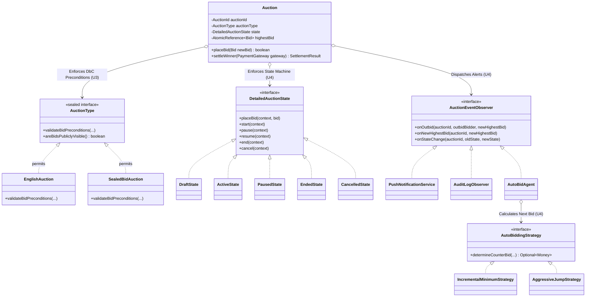

# Online Auction Platform

An enterprise-grade, object-oriented Java 17 implementation of an **Online Auction Platform** designed with **Design by Contract (DbC)**, **Sealed Type Hierarchies**, **GoF Behavioral Design Patterns**, **Atomic Concurrency (CAS)**, and **Domain-Driven Design (DDD)** bounded contexts.

---

## Architecture Overview



---

## Unit Breakdown & Specifications

### Unit 1–2: Domain Foundations & Immutable Value Objects
- **`Money`**: Immutable Java 17 `record` managing precise decimal amounts (`BigDecimal`), rounding (`RoundingMode.HALF_UP`), non-negative invariants, and cross-currency validation.
- **`AuctionId`**: Strongly typed domain identifier preventing primitive obsession.
- **`Bid`**: Immutable record (`bidId`, `auctionId`, `bidderId`, `amount`, `timestamp`).
- **Domain Invariant**: Bids are strictly monotonically increasing: $Amount_{new} \ge Amount_{current} + \text{MinimumIncrement}$.

### Unit 3: Design by Contract (DbC) & Sealed Auction Types
- **Contracts on `placeBid`**:
  - **Preconditions**:
    1. Auction state must be `ACTIVE` ($now < endTime$).
    2. Bidder cannot be the auction seller.
    3. The current winning bidder cannot outbid themselves consecutively.
    4. First bid must satisfy the reserve price; subsequent bids must exceed the current highest bid by at least the minimum increment.
  - **Postconditions**:
    1. `highestBid` points to `newBid`.
    2. `bidHistory` immutably appends `newBid`.
    3. Previously winning bidder receives an outbid notification.
  - **Class Invariants**:
    1. Highest bid is non-decreasing.
    2. Reserve price and increment must be positive.
- **Java 17 Sealed Interface**:
  - `public sealed interface AuctionType permits EnglishAuction, SealedBidAuction`:
    - `EnglishAuction`: Open ascending bidding with real-time public updates and increment validation.
    - `SealedBidAuction`: Blind bid submissions hidden from competitors until the reveal deadline.

### Unit 4: GoF Behavioral Design Patterns
- **State Pattern (`DetailedAuctionState`)**:
  - States: `DRAFT` $\to$ `ACTIVE` $\leftrightarrow$ `PAUSED` $\to$ `ENDED` / `CANCELLED`.
  - Guard clauses ensure that bids are only accepted during `ACTIVE` status.
- **Observer Pattern (`AuctionEventObserver`)**:
  - Subscribers:
    - `PushNotificationService`: Directly alerts outbid users in real-time.
    - `AuditLogObserver`: Logs structured audit data for platform compliance.
- **Strategy Pattern (`AutoBiddingStrategy`)**:
  - `IncrementalMinimumStrategy`: Bids the minimal increment required ($H + \Delta$).
  - `AggressiveJumpStrategy`: Bids multiple increments ($H + k \times \Delta$) to intimidate competing bidders.
- **Pattern Synergy**: `AutoBidAgent` implements `AuctionEventObserver` and encapsulates an `AutoBiddingStrategy`. When outbid, it automatically calculates and places counter-bids until its budget ceiling is reached.

### Unit 5: Winner Settlement & Compensation Workflow
- If the winning bidder's payment fails (credit card decline, insufficient escrow):
  - The transaction initiates a **Compensation Workflow**.
  - A second-chance offer is automatically extended to the second-highest bidder at their recorded bid amount.

### Unit 6: High-Concurrency Last-Second Bidding (CAS)
- High-traffic auctions experience concurrent last-second bids.
- Uses `AtomicReference<Bid>` with a non-blocking **Compare-And-Set (CAS)** loop to guarantee thread safety and eliminate race conditions.

### Unit 7: Bounded Contexts (Domain-Driven Design)
- **`com.auction.domain`**: Core auction entities, value objects, sealed types, and lifecycle states.
- **`com.auction.bidding`**: Bidding contracts, validation engine, and CAS concurrency handler.
- **`com.auction.settlement`**: Payment processing, invoicing, and compensation workflows.
- **`com.auction.notification`**: Observer dispatching, push alerts, and audit logging.

---

## Project Structure

```
online-auction-platform/
│
├── pom.xml                                      # Maven build configuration
├── .gitignore                                   # Git ignore rules
├── README.md                                    # Complete architectural documentation
└── src/
    └── main/
        └── java/
            └── com/
                └── auction/
                    ├── AuctionPlatformDemo.java # Full comprehensive system demo (U1–U7)
                    ├── domain/
                    │   ├── Money.java           # U1-2: Immutable Money record
                    │   ├── AuctionId.java       # U1-2: Strongly typed Auction ID
                    │   ├── Bid.java             # U1-2: Immutable Bid record
                    │   ├── ContractViolationException.java # U3: DbC violation exception
                    │   ├── AuctionType.java     # U3: Sealed interface
                    │   ├── EnglishAuction.java  # U3: English ascending auction
                    │   ├── SealedBidAuction.java# U3: Sealed-bid blind auction
                    │   ├── AuctionState.java    # U4: State interface
                    │   ├── DraftState.java      # U4: State implementations
                    │   ├── ActiveState.java     # U4: State implementations
                    │   ├── EndedState.java       # U4: State implementations
                    │   ├── CancelledState.java  # U4: State implementations
                    │   ├── BidObserver.java     # U4: Observer interface
                    │   ├── OutbidAlertNotifier.java # U4: Concrete observer
                    │   ├── AutoBidStrategy.java # U4: Strategy interface
                    │   ├── IncrementalAutoBidStrategy.java # U4: Concrete strategy
                    │   └── Auction.java         # Core Aggregate Root (U1–U7)
                    └── u4/
                        └── Unit4Demo.java       # Dedicated Unit 4 Showcase
```

---

## How to Compile & Run

### Prerequisites
- **Java JDK 17** or higher (`javac` and `java` on `PATH`)
- Maven (optional)

### Direct Command Line (Standard JDK)
1. **Compile all sources**:
   ```bash
   javac -d bin src/main/java/com/auction/domain/*.java src/main/java/com/auction/u4/*.java src/main/java/com/auction/*.java
   ```

2. **Run Full Platform Demo (U1–U7)**:
   ```bash
   java -cp bin com.auction.AuctionPlatformDemo
   ```

3. **Run Dedicated Unit 4 Demo (State, Observer, Strategy)**:
   ```bash
   java -cp bin com.auction.u4.Unit4Demo
   ```

---

## Verified Execution Output

```
========================================================================
  ONLINE AUCTION PLATFORM - UNIT 4: STATE, OBSERVER & STRATEGY PATTERNS
========================================================================

>>> 1. STATE PATTERN (LIFECYCLE & TRANSITION GUARDS) <<<
Initial State: DRAFT

[Test Guard] Bidder Alice bids $500.00 while in DRAFT state...
>> CAUGHT GUARD: CONTRACT REJECTION: Cannot place bids while auction is in DRAFT state.

[Action] Starting auction (DRAFT -> ACTIVE)...
  [PUSH BROADCAST] -> Auction AUC-U4-VINTAGE-GUITAR transitioned: DRAFT ===> ACTIVE
  [AUDIT LOG] -> State change recorded: DRAFT to ACTIVE

[Action] Alice places initial bid of $500.00...
  [AUDIT LOG] -> Auction AUC-U4-VINTAGE-GUITAR: Bid $500.00 accepted from Alice

[Action] Pausing auction (ACTIVE -> PAUSED for anti-tamper check)...
  [PUSH BROADCAST] -> Auction AUC-U4-VINTAGE-GUITAR transitioned: ACTIVE ===> PAUSED
  [AUDIT LOG] -> State change recorded: ACTIVE to PAUSED

[Test Guard] Bob tries to bid $550.00 during PAUSE...
>> CAUGHT GUARD: CONTRACT REJECTION: Bidding temporarily suspended (Auction PAUSED).

[Action] Resuming auction (PAUSED -> ACTIVE)...
  [PUSH BROADCAST] -> Auction AUC-U4-VINTAGE-GUITAR transitioned: PAUSED ===> ACTIVE
  [AUDIT LOG] -> State change recorded: PAUSED to ACTIVE

>>> 2 & 3. OBSERVER + STRATEGY IN ACTION (AUTO-BIDDING WAR) <<<

[Action] ConservativeBot joins and outbids Alice...
  [AUTO-BID BOT: ConservativeBot_Charlie] -> Initializing bid at $550.00 using 'Conservative Incremental (H + MinIncrement)'...
  [AUDIT LOG] -> Auction AUC-U4-VINTAGE-GUITAR: Bid $550.00 accepted from ConservativeBot_Charlie
  [PUSH NOTIFICATION] -> Sent to Alice: 'You have been OUTBID on AUC-U4-VINTAGE-GUITAR! New highest bid: $550.00 by ConservativeBot_Charlie'

[Action] AggressiveBot jumps in to challenge ConservativeBot...
  [AUTO-BID BOT: AggressiveBot_Diana] -> Initializing bid at $650.00 using 'Aggressive Intimidation (2x Increment)'...
  [AUDIT LOG] -> Auction AUC-U4-VINTAGE-GUITAR: Bid $650.00 accepted from AggressiveBot_Diana
  [PUSH NOTIFICATION] -> Sent to ConservativeBot_Charlie: 'You have been OUTBID on AUC-U4-VINTAGE-GUITAR! New highest bid: $650.00 by AggressiveBot_Diana'
  [AUTO-BID BOT: ConservativeBot_Charlie] -> OUTBID ALERT received! Strategy: 'Conservative Incremental (H + MinIncrement)'.
  [AUTO-BID BOT: ConservativeBot_Charlie] -> Counter-bidding with $700.00 (Budget ceiling: $700.00)...
  [AUDIT LOG] -> Auction AUC-U4-VINTAGE-GUITAR: Bid $700.00 accepted from ConservativeBot_Charlie
  [PUSH NOTIFICATION] -> Sent to AggressiveBot_Diana: 'You have been OUTBID on AUC-U4-VINTAGE-GUITAR! New highest bid: $700.00 by ConservativeBot_Charlie'
  [AUTO-BID BOT: AggressiveBot_Diana] -> OUTBID ALERT received! Strategy: 'Aggressive Intimidation (2x Increment)'.
  [AUTO-BID BOT: AggressiveBot_Diana] -> Counter-bidding with $800.00 (Budget ceiling: $850.00)...
  [AUDIT LOG] -> Auction AUC-U4-VINTAGE-GUITAR: Bid $800.00 accepted from AggressiveBot_Diana
  [PUSH NOTIFICATION] -> Sent to ConservativeBot_Charlie: 'You have been OUTBID on AUC-U4-VINTAGE-GUITAR! New highest bid: $800.00 by AggressiveBot_Diana'
  [AUTO-BID BOT: ConservativeBot_Charlie] -> OUTBID ALERT received! Strategy: 'Conservative Incremental (H + MinIncrement)'.
  [AUTO-BID BOT: ConservativeBot_Charlie] -> Target counter-bid exceeds budget ceiling of $700.00. Bot bows out.

[Action] Human Bidder 'Bob' places $900.00, outbidding AggressiveBot...
  [AUDIT LOG] -> Auction AUC-U4-VINTAGE-GUITAR: Bid $900.00 accepted from Bob
  [PUSH NOTIFICATION] -> Sent to AggressiveBot_Diana: 'You have been OUTBID on AUC-U4-VINTAGE-GUITAR! New highest bid: $900.00 by Bob'
  [AUTO-BID BOT: AggressiveBot_Diana] -> OUTBID ALERT received! Strategy: 'Aggressive Intimidation (2x Increment)'.
  [AUTO-BID BOT: AggressiveBot_Diana] -> Target counter-bid exceeds budget ceiling of $850.00. Bot bows out.

>>> 4. CLOSING AUCTION & FINAL STATE GUARD <<<
  [PUSH BROADCAST] -> Auction AUC-U4-VINTAGE-GUITAR transitioned: ACTIVE ===> ENDED
  [AUDIT LOG] -> State change recorded: ACTIVE to ENDED

[Test Guard] Late bid from Eve ($1200.00) after auction ENDED...
>> CAUGHT GUARD: CONTRACT REJECTION: Auction has ENDED. No more bids accepted.

Final Winning Bid: $900.00 won by Bob
========================================================================
```
